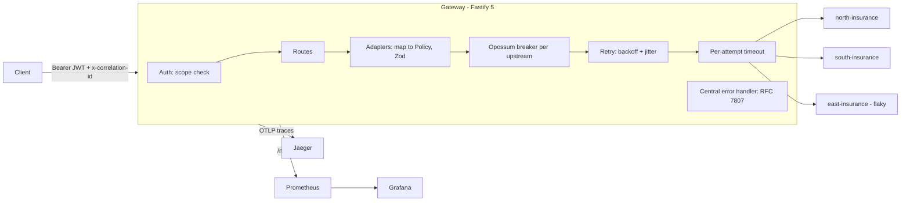

# resilient-api-gateway

A small TypeScript + Fastify 5 gateway that puts several heterogeneous upstream APIs behind **one contract**, and shows the resilience and observability patterns a production gateway needs. Around 600 lines of source, meant to be read.

## The problem

Three upstream providers expose the same business concept (an insurance policy) with different field names, status codes, date formats and money representations. Clients should not care. They also should not go down because one provider is slow, flaky or returning garbage.

| | north | south | east |
|---|---|---|---|
| id / holder | `policy_number` / `holder_id` | `id` / `customer.id` | `ref` / `insured` |
| status | `"ACTIVE"` | `1` | `"A"` |
| dates | `2025-01-02` | `02/01/2025` | epoch seconds |
| money | `120.5` | `12050` (cents) | `"120.50"` |

The gateway answers with a single Zod-validated `Policy`:

```json
{ "id": "P-1001", "provider": "north", "holderId": "H-1", "status": "active",
  "startDate": "2025-01-02", "endDate": "2026-01-02", "premium": { "amount": 120.5, "currency": "USD" } }
```

## Architecture



Request flow: `auth -> route -> adapter -> breaker( retry( timeout( fetch ) ) )`. Every error, wherever it is thrown, ends up in one handler that renders `application/problem+json`.

| File | Responsibility |
|---|---|
| `src/adapters/index.ts` | One adapter per upstream: paths + payload mapping |
| `src/upstream.ts` | Breaker, retry, timeout, fallback error |
| `src/policies.ts` | Single lookup and fan-out/merge |
| `src/errors.ts` | Problem Details, the only error renderer |
| `src/auth.ts` | JWT HS256 + scope guard |
| `src/metrics.ts`, `src/telemetry.ts` | Prometheus and OpenTelemetry |

## Patterns and trade-offs

**Adapter per upstream.** The messy knowledge lives in one file per provider; the rest of the code only sees `Policy`. Upstream payloads are validated before mapping, so a provider silently changing its schema becomes a clear `502`, not a corrupted response. Cost: every new field needs a change in each adapter.

**Circuit breaker (Opossum), one per upstream.** When a provider keeps failing, calling it again only adds latency and load to something already struggling. After the error threshold the breaker opens and requests fail fast with a `503` + `Retry-After`; after `resetTimeout` one probe goes through (half-open) and success closes it. Per-upstream so a sick provider does not take healthy ones down. Trade-off: while open, a provider that recovered early still gets no traffic.

**Retry with exponential backoff, only for transient errors.** 5xx, timeouts and network errors are retried (`UPSTREAM_RETRIES`, default 2). The retry sits *inside* the breaker, so one exhausted call counts as one failure.

- *Why never retry a 4xx:* the request itself is wrong (or the resource does not exist). Sending the same request again cannot succeed, only wastes upstream capacity, and for non-idempotent calls could repeat side effects. 4xx also do **not** count toward opening the breaker: they say nothing about upstream health.
- *Why jitter:* with plain exponential backoff, all clients that failed together retry together, producing synchronized waves (thundering herd) that keep a recovering service down. Full jitter, `sleep = random(0, base * 2^attempt)`, spreads those retries out.

**Per-attempt timeout.** A slow upstream is treated like a failing one; without a bound, slow calls pile up and exhaust the gateway. The timeout is enforced by the gateway itself, not only by passing an abort signal.

**Partial results on fan-out.** `GET /v1/policies?holderId=` queries all providers in parallel. If one fails, the client still gets the others plus a `warnings` array (`[{ "provider": "south", "detail": "..." }]`). Showing most of the data beats showing none, but the client must be able to tell the list is incomplete, hence explicit warnings. Only when *all* providers fail does it answer `502`.

**Problem Details (RFC 7807).** Every error is `application/problem+json` with `type, title, status, detail, instance` plus `correlationId`, produced by one handler. Clients parse one error shape.

**Correlation id.** `x-correlation-id` is accepted or generated, returned in the response, sent to every upstream call and stamped on every pino log line (`correlationId`). Traces: OpenTelemetry HTTP + undici instrumentation exports OTLP to Jaeger.

**Auth.** JWT bearer (HS256, demo only; use asymmetric keys and a JWKS endpoint in production). The `scope` claim must contain `policies:read`: missing/invalid token is `401`, valid token without scope is `403`.

## Quick start

```bash
docker compose up --build

TOKEN=$(npm run -s token)            # needs `npm ci` once; or: node scripts/demo-token.mjs
curl -H "authorization: Bearer $TOKEN" "localhost:3000/v1/policies/P-1001?provider=north"
curl -H "authorization: Bearer $TOKEN" "localhost:3000/v1/policies?holderId=H-1"
```

| Service | URL |
|---|---|
| Gateway | http://localhost:3000 (`/metrics`, `/healthz`) |
| Grafana (anonymous admin) | http://localhost:3001 -> dashboard "Resilient API Gateway" |
| Prometheus | http://localhost:9090 |
| Jaeger | http://localhost:16686 |

`east-insurance` fails ~40% of requests (`FAILURE_RATE` in `docker-compose.yml`). Run the list call in a loop and watch the breaker flip in Grafana and the `warnings` array appear.

> Screenshot placeholder: add a capture of the Grafana dashboard (p95 latency, error rate, breaker state) at `docs/grafana.png` and reference it here.

### Configuration

`PORT`, `JWT_SECRET`, `NORTH_URL`, `SOUTH_URL`, `EAST_URL`, `UPSTREAM_TIMEOUT_MS` (1000), `UPSTREAM_RETRIES` (2), `BACKOFF_BASE_MS` (100), `BREAKER_VOLUME` (5), `BREAKER_ERROR_PCT` (50), `BREAKER_RESET_MS` (10000), `OTEL_EXPORTER_OTLP_ENDPOINT` (tracing is off when unset).

## Development

```bash
npm ci
npm run typecheck
npm test        # fake upstreams injected as fetch: no network
```

Tests inject a fake `fetch`, so retry, breaker, fan-out and correlation rules are verified deterministically with Fastify's `inject`.

## License

MIT
